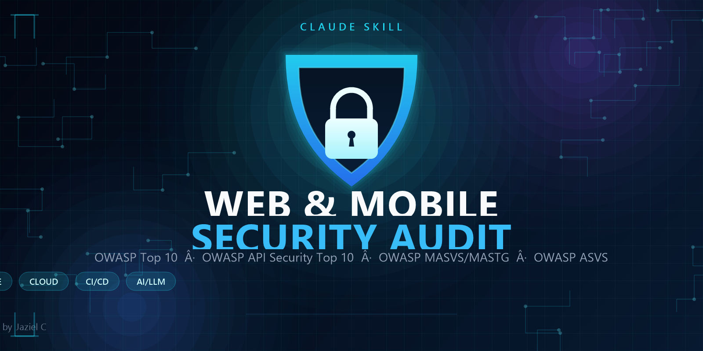

<p align="center">
  
</p>

<h1 align="center">Web &amp; Mobile Security Audit</h1>

<p align="center">
  A Claude skill that audits web apps, APIs, and mobile apps, fixes what is safe to fix,<br>
  and explains the risk in plain English to people without a cybersecurity background.
</p>

<p align="center">
  It adapts the review to the technologies it actually finds (Supabase, Firebase, Cloudflare, Vercel, Stripe, WordPress, Node/Express/Next.js, React/Vue/Svelte, Go, Rust, Laravel, Rails, Spring, .NET, Django, Docker/Kubernetes, and more), so you get concrete findings with file and line references instead of a generic checklist.
</p>

<p align="center">
  <a href="https://github.com/jazielcarballo/web-security-audit/releases"></a>
  <a href="https://github.com/jazielcarballo/web-security-audit/blob/main/LICENSE"></a>
  
  
  
</p>

> **Last updated: 2026-11-05** — added an evidence standard (confirmed / needs validation / rejected), adversarial validation, a coverage ledger with finding fingerprints, anti-patterns, and a deeper control catalog adapted from Cloudflare's `security-audit-skill`. See [CHANGELOG.md](CHANGELOG.md).

## Table of contents

- [About](#about)
- [What it audits](#what-it-audits)
- [What it fixes](#what-it-fixes)
- [Coverage matrix](#coverage-matrix)
- [How it works](#how-it-works)
- [Safety rules](#safety-rules)
- [Installation](#installation)
- [Usage](#usage)
- [Requirements](#requirements)
- [Repository structure](#repository-structure)
- [Contributing](#contributing)
- [Author](#author)
- [License](#license)

## About

**Web & Mobile Security Audit** is a [Claude](https://claude.ai) skill for people who need a serious security review but do not have a security team. It reviews the code and configuration of a web application, API, or mobile app and its backend, identifies the issues that actually matter, fixes the ones that can be fixed safely, and explains every finding in plain language.

It is built for founders, small engineering teams, freelancers, and agencies that ship software and want an honest, evidence-based assessment before or after launch. It is not a scanner wrapper: every finding is reproduced by hand, with a captured request and response or a file-and-line reference, before it goes into the report.

### Why it exists

Most security checklists are either too generic to act on or too technical for the person who has to make the decision. This skill connects the two. It uses the same standards a professional would use — OWASP Top 10, OWASP API Security Top 10, OWASP MASVS/MASTG, and OWASP ASVS — and translates the result into business impact, priorities, and concrete next steps.

### Principles

- **Authorization first.** It stops unless you own the system or have written permission to test it.
- **Evidence over noise.** A scanner result is a lead, not a finding. Every issue is reproduced and documented. Only confirmed findings get a severity; anything that depends on an unseen dashboard or deployment fact is reported as *needs validation*; missing best practices with no reachable impact are hardening notes.
- **Coverage, not a clean bill of health.** It keeps a coverage ledger (`security/coverage.md`) and fingerprints each finding, so a later run can revalidate it instead of duplicating it. One pass never proves a codebase clean.
- **Fix what is safe, ask before changing behavior.** Low-risk fixes are applied automatically; anything that can change how the product behaves is explained and confirmed first.
- **No false confidence.** It never says "your site is secure." It says what was reviewed, what was found, and what was not covered.
- **Plain language.** Every technical term is defined the first time it appears. Findings use business examples, not just CWE numbers.

### Scope

The skill covers the application layer end to end: frontend, backend, database access, authentication, authorization, APIs, file handling, business logic, payments, headers, client-side storage and service workers, availability and resource exhaustion, data lifecycle, infrastructure configuration, dependencies and runtime, CI/CD, cloud and container settings, AI/LLM features, and Android/iOS/hybrid mobile apps.

It also reviews the parts that usually live outside the repository — provider dashboards, DNS, TLS, object storage, email authentication, backups, and monitoring — and writes those as manual steps for you to complete.

### Out of scope

This is not a substitute for a professional penetration test, a compliance certification, or a legal review. It does not test third-party services, perform phishing or social engineering, attack infrastructure outside the agreed scope, or guarantee that no vulnerability exists. For platforms that handle money or sensitive data at scale, use this review as a first pass and pair it with an independent professional assessment.

### Project status

Actively maintained. User-facing changes are recorded in [CHANGELOG.md](CHANGELOG.md), and design decisions and verification steps are recorded in [WORKLOG.md](WORKLOG.md).

## What it audits

The review adapts to the stack it finds. Each control is classified as applicable, handled by the provider, not applicable, manual review, needs validation, or hardening, and the matching technology module is loaded.

### 1. Identity, authentication, and sessions

- MFA on your own admin panels and on every provider dashboard that can control the business: hosting, database, payments, DNS/CDN, source control, and the domain registrar.
- Modern password hashing (Argon2id, bcrypt, or PBKDF2) when authentication is self-built.
- Session cookies with `HttpOnly`, `Secure`, `SameSite`, and the `__Host-` prefix where appropriate.
- JWT hardening: reject `alg: none` and algorithm changes, pin the expected algorithm, verify signatures with the correct key type, validate `exp`, `nbf`, `aud`, `iss`, and `jti`, reject unknown `crit` headers, never trust token-supplied `jku`/`x5u`/`jwk`, and resolve `kid` only from a fixed server-side map.
- Refresh-token rotation with reuse detection and a server-side deny-list by `jti`.
- OAuth/OIDC: exact `redirect_uri` matching, single-use `state` bound to the session, `nonce`, PKCE, no implicit or password grants, strict audience/issuer checks, selected-IdP binding, ID-token versus access-token confusion, account-linking CSRF, scope validation, and token leakage through `Referer`.
- SAML, when used: signed-element identity, safe XML parsing, audience, recipient, validity window, request correlation, and replay state.
- OTP, magic links, and invites: single use, short expiry, bound to the user and purpose, rate-limited, never returned in the API response, and compared in constant time.
- MFA bypass checks: OTP replay, backup codes, "remember this device" tokens, and response manipulation. MFA is bound to the session, account, action, and assurance target; step-up does not upgrade a different session or account.
- Passkeys/WebAuthn: challenge, RP ID, origin, credential, user handle, and user verification bound at registration; challenge, RP/origin, credential membership, and signature verified at login.
- Account linking and API keys: current session, verified ownership, and step-up for linking; scoped, rotatable keys with resource and tenant binding, never treated as authentication by themselves.
- Rate limiting and CAPTCHA on login, signup, password reset, and other sensitive flows, counted from the earliest pre-authentication work.
- Server-side session invalidation on logout, password change, account disable, and role or membership changes; rotation on login, MFA completion, account switch, and impersonation; session fixation protection; inactivity timeout.
- Single-use reset tokens, configured reset domains, and no `Host` header injection into reset links. Recovery is the weakest path: review backup codes, support recovery, email/phone change, and whether old tokens die.
- Cookie scope is narrow (`Domain`, `Path`), never crosses insecure transport, and does not collide with a sibling cookie another component selects differently; a bare missing flag is hardening unless a realistic reader can gain or replace it.
- User enumeration resistance across login, signup, password reset, and invites.
- Rejection of default and well-known credentials; failed-login logging with IP and user agent.
- Mobile token storage in Keychain or Keystore, never in `UserDefaults`, `SharedPreferences`, `AsyncStorage`, or a plist; biometric-bound keys where appropriate; logout that clears and revokes tokens.

### 2. Access control

- Least privilege per role, with admin and internal routes blocked at the API.
- BOLA/IDOR on every HTTP verb and representation: read, list, count, nested resources, bulk and batch operations, exports, downloads, pagination cursors, filters, GraphQL Relay IDs, gRPC IDs, signed URLs, and cloud object URLs. A `tenant_id` or `owner_id` column is not isolation; the query, key, policy, or filter must enforce it on every path.
- BFLA: admin and internal endpoints tested with every role and every HTTP method, including method-override headers and content-type switching. Hiding a route in the UI is not access control.
- Object-property-level authorization: responses return only the fields the caller may see, with no internal IDs, password hashes, tokens, counters, or other users' PII.
- Mass assignment: explicit allowlists per endpoint; protection for fields such as `role`, `plan`, `is_admin`, `owner_id`, `price`, `payment_status`, `credit_balance`, and `permissions`.
- Excessive data exposure: the API returns only what the client needs, including joins, aggregates, aliases, and views that can widen the result set.
- Multi-tenant isolation through body, headers, filters, cursors, invitations, exports, and background jobs.
- Indirect privilege through sharing, collaboration, invites, API keys, and jobs that must not grant more access than their creator has.
- Policy/query disagreement between row-level policy, ORM scopes, raw SQL, bypass clients, and service roles; composite-key or namespace collisions; per-item authorization on bulk, stream, and subscription paths; stale authorization after a role, membership, or secret change.

### 3. Input and output

- SQL, NoSQL, OS command, LDAP, and XPath injection, including NoSQL operators (`$ne`, `$gt`, `$where`) and raw ORM fragments, plus injection through field names, JSON keys, headers, and metadata.
- Second-order injection: data stored safely, then read and used in a dangerous context by different code.
- XSS in HTML, attribute, JavaScript, URL, and CSS contexts: stored, reflected, DOM-based, blind, mutation, and polyglot variants, plus framework sinks such as `innerHTML`, `dangerouslySetInnerHTML`, `v-html`, `{@html}`, `|safe`, `mark_safe`, and `{!! !!}`. DOM clobbering through attacker-injected `id`/`name` attributes is checked as well.
- CSP quality, nonces or hashes, and Trusted Types; a weak CSP never counts as an XSS fix.
- CSRF protection for cookie-based sessions, with `SameSite` treated as defense in depth rather than a replacement for tokens. Every cookie-authenticated mutation is inventoried, including form, JSON-like, multipart, method-override, and legacy routes; login CSRF is separate.
- File uploads: magic-byte validation, size limits, renamed files, storage outside the web root, SVG/HTML restrictions, metadata stripping, image re-encoding, polyglot detection, ZIP-bomb limits, filename injection, `phar://` on PHP, and CDN/image-pipeline behavior.
- SSRF: allowlists, blocking of internal networks and every cloud metadata endpoint (AWS IMDSv2, GCP, Azure, and equivalents), validation after redirects and DNS resolution, and coverage of webhooks, imports/exports, avatar URLs, PDF generators, and screenshot services.
- Open redirects and bypasses using `//evil`, `@`, backslashes, encoding, subdomains, and `javascript:`.
- Path traversal and arbitrary file read through encoded separators, absolute paths, and null bytes. Archive extraction checks zip-slip, symlinks, compression bombs, and TOCTOU.
- Trust in `Host`, `Forwarded`, `X-Forwarded-*`, `Origin`, and `Referer`, plus response-header injection and web cache poisoning/deception through unkeyed request values.
- XXE in XML, SAML, SVG, DOCX, and XLSX parsers, including content-type switching, parameter entities, error-based, and out-of-band variants.
- Insecure deserialization in Java, .NET, PHP, Python, Node.js, and Ruby, including `ObjectInputStream`, `BinaryFormatter`, `TypeNameHandling`, `unserialize`, `phar://`, `pickle`, `yaml.load`, `node-serialize`, `Marshal.load`, and ViewState.
- Server-side template injection across Jinja2, Twig, Freemarker, Velocity, Pebble, Thymeleaf, Smarty, Mako, ERB, Handlebars, and EJS.
- Prototype pollution through recursive merges, `__proto__`, `constructor.prototype`, query parsers, and client-side sinks; pollution without a reachable gadget is not a finding.
- HTTP parameter pollution and cloaking where the WAF, gateway, and backend disagree about which duplicate parameter wins.
- Request smuggling and desync through `Content-Length`/`Transfer-Encoding` conflicts, HTTP/2 downgrade, and client-side desync.
- CSV and formula injection in exports, plus ReDoS and algorithmic complexity through user-supplied regex, deeply nested JSON/XML, huge pagination, and zip bombs.
- Dangerous execution sinks: `eval`, `new Function`, `child_process`, `exec`, `system`, `popen`, `Runtime.exec`, dynamic includes, and template compilation from user input.

### 4. APIs

- CORS: no wildcard with credentials, exact origin allowlists, rejection of `null`, no reliance on `Origin` for authentication, and weak reflected origins (substring, prefix, suffix, unanchored regex) tested with credentials.
- REST: verb tampering, `X-HTTP-Method-Override`, content-type switching, mass assignment, excessive data exposure, inconsistent authorization between versions, and streaming routes where a stream authorized once must re-authorize after a role change and per item.
- GraphQL: introspection, depth/complexity/alias limits, batching and brute-force amplification, Relay IDOR, nested-field authorization, mutation and subscription authorization, endpoints enabled by default, field-level gaps, CSWSH, field-suggestion schema leakage, file upload, GET versus POST, and CSRF.
- gRPC: reflection exposure, per-method authentication and authorization, metadata injection, BOLA, deadlines, message-size limits, TLS, and protobuf fuzzing.
- WebSockets and realtime: origin validation, handshake and per-message authentication, subscription authorization, CSWSH, message injection, size and rate limits, and token expiry on long-lived connections.
- API inventory: old versions, internal and debug endpoints (`/swagger`, `/openapi.json`, `/graphiql`, `/actuator`, `/_profiler`, `/debug`), exposed specs, source maps, mobile-only endpoints, and deprecated routes.
- Rate limiting per user, IP, API key, and tenant on login, OTP, password reset, search, export, webhook registration, and expensive operations.
- Webhooks: raw-body signature verification, source/account/audience/event binding, idempotency by event ID, replay protection, duplicate and out-of-order handling, event filtering, secret rotation, correlation-ID binding, and SSRF-safe callback URLs.
- API keys: no keys in client bundles or mobile binaries, scoped and rotated keys, domain/IP restrictions, and separate keys per environment.
- Pagination and cursors: capped page size, no unauthorized total counts, validated cursors, no client-controlled sort or filter fields, and filter/sort treated as authorization inputs.
- HTTP/2 and HTTP/3 checks against rapid-reset and smuggling advisories, plus header and body size caps.

### 5. Headers and transport

- HTTPS enforced, TLS 1.2 minimum with 1.3 preferred, HSTS with `includeSubDomains` and preload when ready.
- CSP with nonces or hashes, `frame-ancestors`, `object-src 'none'`, and `base-uri 'self'`.
- `X-Content-Type-Options`, `Referrer-Policy`, `Permissions-Policy`, and cross-origin isolation headers where compatible.
- Caching rules that keep personalized responses out of shared caches, correct `Vary` behavior, and cache keys that include every identity dimension.
- Removal of `Server`, `X-Powered-By`, stack traces, and framework debug pages in production.
- Certificate expiry monitoring, CAA records, and certificate transparency monitoring.
- A missing header is hardening, not a finding, unless a demonstrated sink or bypass makes it exploitable here. Mixed content, protocol downgrade, and certificate validation still count when they expose or corrupt data.

### 6. Business logic

- State-machine bypass: skipping a required step, replaying a one-time action, downgrading a state, or calling a hidden endpoint directly.
- Price, quantity, and currency manipulation: negative or fractional quantities, hidden price fields, currency confusion, coupon stacking and reuse, expired coupons, coupons applied to the wrong product, and cart SKU tampering.
- Refund, chargeback, and payout abuse: refunding more than was paid, refunding to a different method, returning less than claimed, payout races, and duplicate credits.
- Trial, referral, and quota abuse: email aliases, disposable numbers, device-ID rotation, referral loops, tier downgrade that keeps premium features, mid-cycle quota resets, and add-on stacking.
- Time-based logic: promotion windows, spoofed forwarding headers, date headers, token expiry, and scheduled jobs that trust client time. Clock skew, timezone, DST, and boundary values across app, database, queue, and provider are checked separately.
- Anti-automation quality: CAPTCHA, rate limits, device fingerprint, and velocity checks, with no single control treated as sufficient.
- Type confusion: arrays where strings are expected, objects where numbers are expected, extra fields, and unexpected nulls.
- Partial failure, retry, and idempotency: a timeout after the provider committed, a retry that duplicates a side effect, and a default/fallback branch that skips a business rule.
- Numeric and rounding limits: negative, zero, fractional, overflowing, and unit-confused values survive to the money or inventory path.

### 7. Payments

- Card data never touching your servers, using hosted checkout or provider elements.
- Webhook signature verification over the raw body, bound to source/account/audience/event, idempotency by event ID, out-of-order event handling, and replay rejection.
- Server-side price and plan selection; the client's amount is never accepted, and provider portal changes are applied server-side rather than trusted from the browser.
- Paid access activated from the webhook, not from the success page. A provider success with a failed local write, or vice versa, is reconciled explicitly.
- Cancellations, failed payments, refunds, chargebacks, and payouts handled correctly.
- 3-D Secure/SCA where required and validated return URLs.
- Separate production and test credentials, restricted API keys, and no secret key in browser or mobile code.

### 8. Infrastructure and perimeter

- Secrets out of code and git history; only public-by-design keys in frontend code.
- `.env`, `.git`, `.svn`, `.DS_Store`, `WEB-INF`, `phpinfo()`, backups, and source maps not web-accessible.
- WAF and anti-DDoS treated as mitigation, never as authorization.
- Databases not reachable without controls; self-managed servers with minimal ports, non-root users, updated systems, no privileged containers, no Docker socket, and seccomp/AppArmor. Check whether a public database was actually ransomed, not only whether the port was open.
- Cloud: least-privilege IAM, no wildcard policies, no long-lived root keys, MFA on root, no public buckets/snapshots/disks, hardened metadata service (IMDSv2), audit logs, managed secret stores, and firewall review.
- Kubernetes: least-privilege RBAC, network policies, no unnecessary service-account token automount, admission control, resource limits, and no plaintext secrets in manifests.
- Workload identity and trusted proxies: only the edge may set identity headers; ingress reachability, configuration precedence (env file, mounted secret, provider dashboard, runtime default), and secret lifecycle (creation, rotation, revocation, stale copies) are verified.
- Event-source identity: queue, cron, and function triggers verify who may invoke them and that they cannot be called directly with forged context.
- Exposed dashboards and datastores: Kibana, Grafana, Prometheus, Jenkins, ArgoCD, etcd, Consul, Vault, Redis, MongoDB, Elasticsearch, Docker API, and the Kubernetes API.
- Cache and CDN: no caching of authenticated responses, cache-poisoning checks through unkeyed headers, and cache-deception checks through URL extensions.
- DNS: no orphaned subdomains pointing to decommissioned services; CAA records configured.
- Cost abuse ("denial of wallet"): paid API keys restricted by domain, quotas, and billing alerts.
- Object storage: no public buckets or objects, reviewed policies and ACLs, short-lived signed URLs, and no reuse of a signed URL for a different object.
- Email authentication: SPF, DKIM, and DMARC published so nobody can send mail as the business.
- Egress restricted to an allowlist or proxy so SSRF and compromise cannot reach internal services freely.

### 9. Secure development, dependencies, supply chain, and CI/CD

- Dependency audit with the package manager (`npm audit`, `pip-audit`, `govulncheck`, `cargo audit`, `bundle audit`, and equivalents), Dependabot or equivalent, and an SBOM. Review the full history, not only the latest lockfile.
- Runtime and base-image versions read from the running process, checked against patched releases, end-of-life status, GitHub Advisories, OSV, and CISA KEV.
- Static analysis with Semgrep and the stack's own tools, plus a baseline dynamic scan on staging.
- Lockfile committed and installed from the lock (`npm ci`, `composer install`, hashed `pip install`); dependency source and scope are verified so a private name cannot be claimed publicly (dependency confusion).
- Mutable build inputs: `latest` tags, unpinned actions, unpinned base images, and remote scripts. Build context excludes secrets and `.git`; artifact signing, provenance, release integrity, and update-path signing are reviewed. No unreviewed package is added during an incident.
- CI/CD: secrets in the CI secret store, fork PRs without secrets, careful `pull_request_target`, no `github.event.*` interpolation into `run:`, least-privilege tokens, OIDC instead of long-lived cloud keys, environment approvals, isolated self-hosted runners, and cache/artifact poisoning protection. Do not put trusted and untrusted jobs in the same runner or cache scope.
- Incident response when a critical advisory was public while the system was exposed: webshells, modified files, unknown users and cron jobs, outbound connections, log review, secret rotation, and a written exposure record.

### 10. Monitoring, data lifecycle, backups, and compliance

- Logs for failed logins, permission changes, data exports, admin actions, and errors, with no passwords, tokens, or card data; check whether private content or credentials leak into analytics, traces, error reporting, or operator-only views.
- Alerts on 401/403/429 spikes, WAF blocks, new admin users, mass data access, unusual exports, and billing anomalies.
- Automated backups and a restore that has actually been tested. Restored data, credentials, memberships, and permissions are re-authorized and re-apply lifecycle changes made after the snapshot.
- Derived copies follow the source of truth: search indexes, caches, thumbnails, previews, RSS, analytics, replicas, and exports are invalidated when a record's ACL, ownership, or deletion state changes. Test retrieval time, not only ingestion.
- Export and backup scope: a low-privilege user cannot trigger an export, report, or snapshot that includes other tenants, inaccessible fields, soft-deleted data, secrets, or history above their access. The final download is authorized too.
- Import and restore scope: archive contents are untrusted, cannot overwrite existing resources, cannot inject records into collections the requester cannot write, and respect the same permission model as the UI.
- Deletion is a contract: soft-delete/tombstone predicates apply to direct lookup, search, relation traversal, object links, background jobs, and restore; queued work does not recreate the data; identifiers cannot be re-registered while references remain.
- Migration: old records without tenant/ACL/lifecycle fields, colliding IDs, partial rollout, dual-read/write, and rollback must not apply weaker defaults.
- Privacy notice and the applicable data-protection law (for example, LFPDPPP in Mexico or GDPR in Europe), with a recommendation to confirm the current version with a specialist.
- PCI-DSS scope explained clearly, especially when hosted checkout keeps the burden minimal.

### 11. AI and LLM features

- Model output treated as untrusted before it reaches a shell, database, browser, or tool. Prompt injection alone is not a finding; require a code-level boundary failure with a real impact.
- User confirmation for actions with side effects and a least-privilege tool allowlist. Approval binds the tool, complete arguments, requester, target, amount, expiry, and batch membership.
- Direct and indirect prompt injection through RAG documents, web pages, emails, files, tool output, and metadata, including cross-session/cross-tenant context bleed and persistent memory poisoning.
- RAG permission filtering in the retrieval layer, not in the prompt.
- Tool-argument validation, confused-deputy checks, dispatcher/schema disagreement, delegated-agent budgets, and MCP/sub-agent identity routing.
- Output encoding before rendering model content as HTML or Markdown, plus sandboxing of generated code and links.
- Server-side model keys, spending limits, per-environment separation, PII-redacted logs, and deliberate model/version pinning.

### 12. Mobile apps (Android and iOS)

- Static review of the APK/IPA for hardcoded secrets, API keys, endpoints, debug logs, and test credentials.
- Manifest and `Info.plist` review: `android:exported`, permissions, `allowBackup`, `debuggable`, cleartext traffic, network security config, ATS exceptions, URL schemes, associated domains, and third-party SDKs.
- Data at rest in Keychain or Keystore, never in `UserDefaults`, `SharedPreferences`, `AsyncStorage`, plists, SQLite, logs, backups, clipboard, or screenshots.
- OAuth Authorization Code with PKCE, verified App Links/Universal Links, no client secrets in the binary, short sessions, and server-side revocation.
- TLS 1.2+, no cleartext, no trust-all `TrustManager`, certificate pinning and app attestation (Play Integrity, DeviceCheck/App Attest) verified server-side.
- Exported activities, services, receivers, and content providers; intent redirection; mutable `PendingIntent`; deep-link and Universal Link parameter validation; iOS URL schemes, XPC, app groups, and shared containers.
- WebView safety: no unnecessary JavaScript bridges, URL validation, no `file://` access from file URLs, safe `addJavascriptInterface`, navigation allowlists, and safe WKWebView message handlers.
- Backend parity: device-bound headers and request-signing algorithms are extractable, so mobile-only endpoints still need the same authorization and rate limits.
- Resilience and privacy: root/jailbreak detection, anti-tampering, obfuscation, minimal permissions, tracking-SDK review, iOS privacy manifest, Android data-safety declarations, signed releases, and a secure update path.

### 13. Race conditions and concurrency

- Simultaneous requests against coupons, balances, stock, votes, follows, invites, password reset, OTP, refunds, payouts, quotas, and rate limiters.
- Multi-endpoint races, connection-pool exhaustion, cache stampede, queue consumers, serverless concurrency, and database isolation levels.
- Bounded single-packet or parallel bursts on staging only.
- Fix verification through transactions, row locks, unique constraints, atomic counters, idempotency keys, queue serialization, and duplicate-effect monitoring.

### 14. Client-side and browser

- Service workers: script URL, MIME type, origin, scope, and imports controlled by the app; cache keys and cleanup include account, tenant, and auth state so a previous user's response is not served after logout or account switch.
- Browser storage: tokens, private responses, drafts, and authorization decisions do not outlive logout, account switch, or revocation, and are not readable by a less-trusted same-origin component. A stored token alone is not a finding; require a realistic reader or continued use after revocation.
- `postMessage`: exact origin allowlist and, for same-origin frames, `event.source`; no sensitive data sent to `*`, and no substring, prefix, suffix, or unanchored-regex origin checks.
- Cross-context state: `storage` events, `BroadcastChannel`, shared workers, and named windows bind identity and commands to the current session; a stale tab cannot overwrite newer auth state.
- XS-Leaks and cross-origin state oracles: load/error, frame state, redirects, timing, cache state, or response size must not reveal a concrete secret-bearing predicate while the browser attaches victim credentials. Generic timing variance is not a finding.
- Clickjacking: a framed state-changing action has effective `frame-ancestors` or equivalent isolation. Missing headers on read-only content are hardening.
- Third-party scripts: SRI and origin reviewed, no secrets shipped in public JavaScript, and a defined blast radius for a compromised script (CSP, sandbox, separate origin).

### 15. Availability and resource exhaustion

- A missing rate limit alone is not a finding. Require an input-to-cost path, a missing effective bound, and impact on another user, shared service, or operator-owned spend.
- Computational amplification: catastrophic regex backtracking, nested parsing, recursive validation, template expansion, adversarial sort/hash, and decompression or representation bombs. Derive the accepted depth/cardinality and show a bounded local growth curve.
- Query amplification: a small request causes broad scans, pathological joins, fan-out, unbounded sort/aggregation, or many downstream calls because depth, filter cardinality, pagination, or expansion fields are not bounded.
- Unbounded buffering and cardinality: bodies, streams, uploads, sessions, unique cache keys, metrics labels, log fields, subscriptions, and pending jobs have per-item and aggregate limits, with cleanup on disconnect, timeout, cancellation, and partial parse.
- Handle and temporary-resource leaks: malformed or canceled work releases sockets, files, cursors, timers, subprocesses, and temp files. Confirm the leak repeats locally and affects a shared pool.
- Detached work and cancellation: client timeout or disconnect propagates a deadline; work does not keep running after authorization fails or the request is canceled.
- Pre-authentication work imbalance, quota scope and reset (no attacker-influenceable IP, route, tenant, key prefix, or task ID to escape a budget), and poison-record/retry-storm/recovery behavior.

## What it fixes

### Applied automatically (no confirmation needed)

- Context-aware output escaping and safe templating.
- Security headers: HSTS, CSP, `frame-ancestors`, `X-Content-Type-Options`, and `Referrer-Policy`.
- Parameterized queries and safe ORM usage.
- Dependency patch and minor updates that do not change behavior.
- `.gitignore` entries for secrets, environment files, and build artifacts.
- Disabling directory listing, debug pages, and published source maps.
- Session cookie flags and other secure defaults.
- Mobile safe configuration: removing secrets and debug logs, moving tokens to secure storage, disabling cleartext traffic, `allowBackup`, and `debuggable`, and restricting WebView file access and JavaScript bridges.

### Applied with confirmation (behavior can change)

- CORS, caching, data-access policies, and row-level security.
- Major version upgrades and runtime or base-image upgrades.
- Blocking routes, changing authentication flows, or enforcing CSP (report-only first).
- Certificate pinning, app attestation, root/jailbreak detection, and obfuscation, because they can break updates or older devices.
- Protocol hardening: rejecting ambiguous requests, duplicate parameters, and unexpected content types.

### Manual actions (external dashboards)

- MFA on hosting, database, payments, DNS/CDN, source control, and registrar accounts.
- Key rotation, token revocation, and secret rotation in provider consoles.
- DNS, CAA, SPF, DKIM, and DMARC records.
- Cloud IAM, public-access blocks, audit logging, and billing alerts.
- WAF rules, backup schedules, and restore tests.
- Mobile signing keys, store protections, and attestation configuration.

### Verification after fixing

The skill re-runs the exact check that proved the vulnerability — same request, same payload, same account pair — and records each finding as `open`, `fixed`, or `verified`. A green build is not proof that the security bug is gone; only the repeated proof is. It also verifies that the application still builds and that existing tests pass.

### Coverage ledger and finding fingerprints

Each run writes `security/coverage.md`: what was reviewed, with which method, in which revision, and what was deliberately not reviewed. Each confirmed finding gets a stable fingerprint so a later audit revalidates it instead of duplicating it, and an "assumption rejected" note records what was tested and found safe. This is how the skill shows coverage without pretending the absence of findings means the code is secure.

### Incident response

If a critical advisory was public while the system was exposed, patching is not the end. The skill runs an incident-response pass: it looks for webshells and modified files, unknown admin or database users, new cron jobs and scheduled tasks, outbound connections to unknown hosts, and unusual requests in the logs around the exposure window. It then rotates every secret the process could read and records the exposure dates and exactly what was checked.

## Coverage matrix

| Area | Web | API | Mobile |
| --- | --- | --- | --- |
| Identity, authentication, sessions | Yes | Yes | Yes |
| Access control, IDOR, BOLA, BFLA | Yes | Yes | Yes |
| Injection, XSS, CSRF | Yes | Yes | Yes |
| File uploads and file handling | Yes | Yes | Yes |
| SSRF, XXE, deserialization, SSTI | Yes | Yes | Partial |
| Business logic and payments | Yes | Yes | Yes |
| Headers and transport | Yes | Yes | Yes |
| Cloud, containers, CI/CD, supply chain | Yes | Yes | Yes |
| AI/LLM features | Yes | Yes | Yes |
| Client-side storage, service workers, postMessage | Yes | Partial | Partial |
| Availability and resource exhaustion | Yes | Yes | Partial |
| Monitoring, data lifecycle, backups | Yes | Yes | Yes |
| Mobile storage, deep links, WebView | — | — | Yes |
| Race conditions and concurrency | Yes | Yes | Yes |
| Plain-language report and manual checklist | Yes | Yes | Yes |

## How it works

| Phase | What happens | Output |
| --- | --- | --- |
| 1. Understand | Reads the repository, config, infrastructure, and mobile project; identifies the stack, users, data, and attack surface. | Plain-language project summary and proposed scope |
| 2. Decide | Classifies every control as applicable, provider-handled, not applicable, manual review, needs validation, or hardening; loads the matching stack modules. | Review plan and coverage ledger tailored to the actual technology |
| 3. Review | Inventories endpoints and client boundaries, builds an authorization matrix, tests with two accounts, walks happy and sad paths, scans with tools, and reproduces every finding by hand. | Evidence with file/line or request/response |
| 4. Fix | Applies safe fixes, asks before behavioral changes, writes manual dashboard steps, and re-tests each finding. | Branch with one commit per finding and verified status |
| 5. Explain | Writes `security/report.md` in the user's language, with severity, business impact, analogies, and a glossary. | Report a non-specialist can act on |

## Safety rules

The skill is safety-first and will not proceed without confirmation that you own the system or have written authorization.

- Active testing runs only against local or staging environments; production gets passive reads only.
- Payments are tested in sandbox or test mode.
- Mobile testing is limited to builds and test devices you control.
- Request smuggling, cache poisoning, race-condition bursts, and credential brute force never run against production or shared infrastructure.
- Every test is throttled, with a small request budget and an immediate stop if the service degrades.
- Third-party services, phishing, and social engineering are out of scope.
- Real user data is never exfiltrated or pasted into the report; secrets are redacted.
- Findings use test accounts (user A and user B), and evidence is limited to what proves impact.
- A WAF blocking a probe is not proof that the vulnerability is absent.
- The report is kept out of public repositories when it contains sensitive findings.

## Installation

Clone or copy this folder into your Claude skills directory.

**macOS / Linux**

```bash
git clone https://github.com/jazielcarballo/web-security-audit.git ~/.claude/skills/web-security-audit
```

**Windows (PowerShell)**

```powershell
git clone https://github.com/jazielcarballo/web-security-audit.git "$env:USERPROFILE\.claude\skills\web-security-audit"
```

Or download `SKILL.md` and place it at `<skills-dir>/web-security-audit/SKILL.md`.

## Usage

This skill is set to **explicit invocation only** (`disable-model-invocation: true`), so it will not trigger on its own. Invoke it by name:

```text
/web-security-audit
```

Or ask directly, for example:

> Run a security audit on this project and explain the risks in plain language.

You can point it at a web app, an API, a mobile app, or all three:

> Audit the web app and the Android app, including the backend API, and write the report in Spanish.

## Requirements

- Claude with skill support (Claude Code, Claude desktop app, or Claude.ai).
- The optional toolchain it may suggest (`gitleaks`, `semgrep`, `npm audit`/`osv-scanner`, `testssl.sh`, OWASP ZAP, `nuclei`, `jwt_tool`, `grpcurl`, `websocat`, `trivy`, `checkov`, `syft`, `cosign`, MobSF, `apktool`/`jadx`, Frida/objection) is used only with your confirmation.

## Repository structure

```text
web-security-audit/
├── assets/
│   └── cover.png   # Repository cover image
├── SKILL.md        # The skill (frontmatter + instructions)
├── README.md
├── CHANGELOG.md    # Dated record of user-facing changes
├── WORKLOG.md      # Dated work log: decisions and verification
└── LICENSE
```

## Contributing

Contributions are welcome. If you find a missing control, a false positive pattern, or a stack that needs its own module, open an issue with the scenario and, if possible, a minimal reproduction. Keep the safety rules intact: no offensive tooling that runs against production, and no techniques that require attacking third-party services.

## Author

Created and maintained by **Jaziel A. Carballo Tadeo**, a PhD candidate in Geospatial Information Sciences at [CentroGeo](https://www.centrogeo.org.mx) (National Geointelligence Laboratory), where he researches the use of artificial intelligence for the preservation of Yucatec Maya. He is a Systems Engineer and Master in Engineering from Tecnológico Nacional de México, with a teaching specialization from the Universidad Autónoma de Yucatán (UADY).

With over 10 years of experience, he teaches at [Universidad Anáhuac Mayab](https://www.anahuacmayab.mx). He is a certified Google Education Educator for Gemini, a former Teaching With Purpose fellow at Harvard Business Publishing, and was accepted to the Lisbon Machine Learning School (LxMLS 2026), part of the European ELLIS network for deep machine learning.

His research and teaching interests include natural language processing, indigenous languages, generative artificial intelligence, and AI applied to education.

- Website: [jazielcarballo.com](https://jazielcarballo.com)
- GitHub: [@jazielcarballo](https://github.com/jazielcarballo)
- Research group: [GILTIA profile](https://giltia.github.io/author/jaziel-a.-carballo-tadeo/)
- Email: [jaziel.carballo@gmail.com](mailto:jaziel.carballo@gmail.com)

## License

[MIT](LICENSE)
